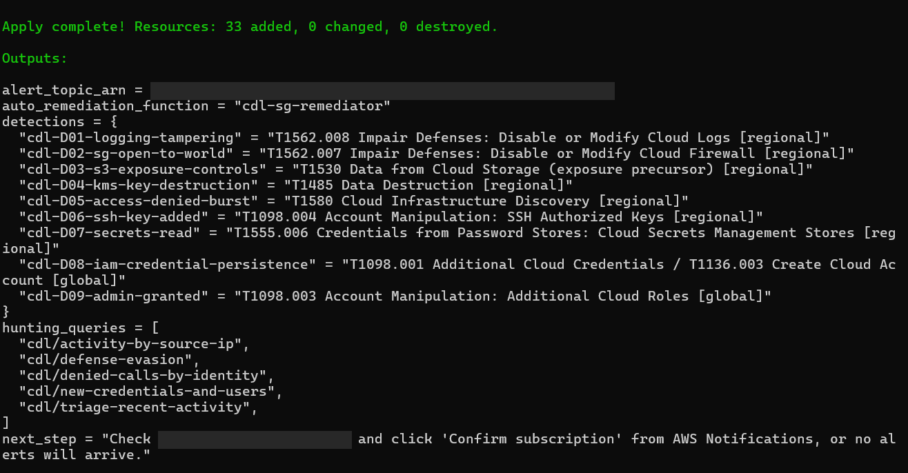
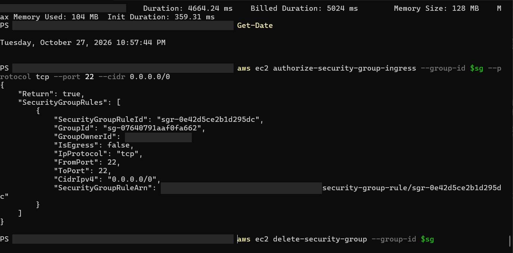
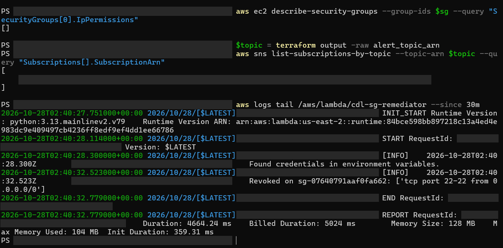
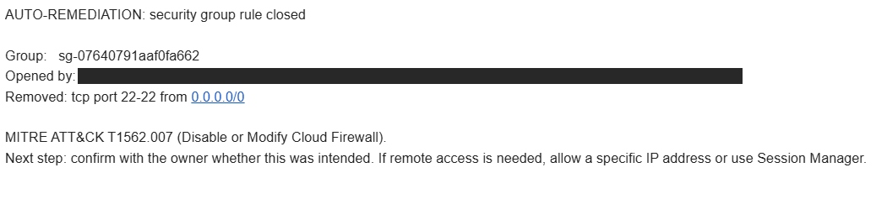
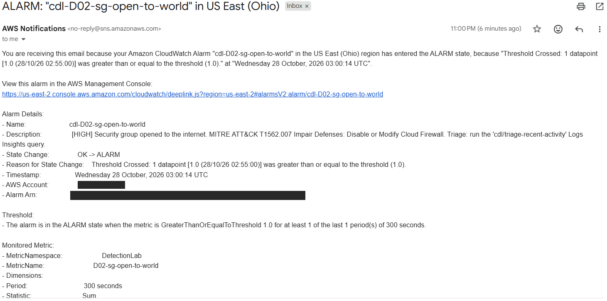
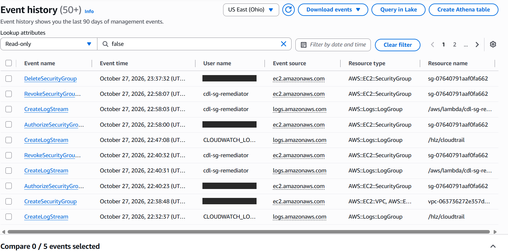
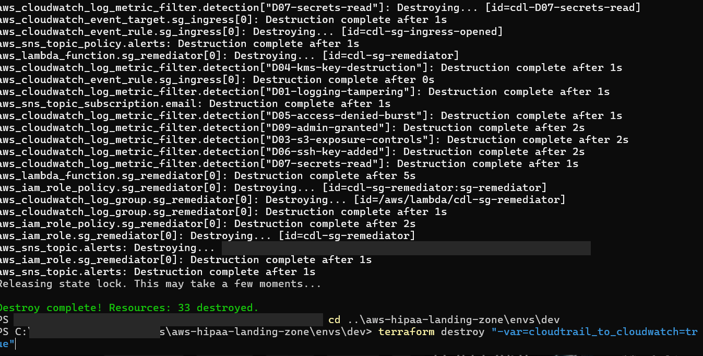

# Results: first live run

October 27, 2026, on an AWS free-plan "projects" account in us-east-2.
Account numbers, session IDs, request IDs and the alert email address are
blacked out in every screenshot.

## Headline numbers

| Measure | Result |
|---------|--------|
| Resources deployed | 29 (landing zone) + 33 (lab) |
| World-open SSH rule closed automatically | **9 s** (test 1), **7 s** (test 2), from the API call to the revoke |
| Lambda run time | 4.7 s |
| D02 alarm email after the change | **2 min 14 s** (test 2) |
| Cost | $0; everything destroyed at the end of the session |

Times come from CloudTrail event history (the `AuthorizeSecurityGroupIngress`
call and the Lambda's `RevokeSecurityGroupIngress`), the Lambda log, and the
alarm's own timestamp.

## 1. Deploy

The landing zone was rebuilt with `cloudtrail_to_cloudwatch=true` (29
resources), then the lab on top of it.

## 2. Simulated attack: SSH opened to the internet

On a throwaway security group attached to nothing, port 22 was opened to
`0.0.0.0/0`, the misconfiguration MITRE ATT&CK tracks as T1562.007.

## 3. Automatic response

EventBridge caught the API call and invoked `cdl-sg-remediator`. A few seconds
later the group's inbound rules were empty (`[]`), and the function's log
records exactly what it revoked.

The alert names the group, who opened the rule, what was removed, the ATT&CK
technique, and the analyst's next step.

## 4. Detection

The CloudWatch alarm for D02 crossed its threshold and emailed the SOC topic
with severity, technique and the triage query to run.

## 5. Investigation: the timeline in CloudTrail

Both test runs read cleanly in CloudTrail event history: the human opens the
rule, and the remediator (its own identity, `cdl-sg-remediator`) closes it
seconds later.

| Time (ET) | Event | Who |
|-----------|-------|-----|
| 22:38:48 | CreateSecurityGroup | analyst session |
| 22:40:23 | AuthorizeSecurityGroupIngress (port 22, 0.0.0.0/0) | analyst session |
| 22:40:32 | RevokeSecurityGroupIngress | cdl-sg-remediator |
| 22:58:00 | AuthorizeSecurityGroupIngress (test 2) | analyst session |
| 22:58:07 | RevokeSecurityGroupIngress | cdl-sg-remediator |
| 23:00:14 | D02 alarm OK → ALARM | CloudWatch |
| 23:37:32 | DeleteSecurityGroup (cleanup) | analyst session |

## 6. Tear down

The landing zone was destroyed after it (29 resources).

## What went wrong, and what it taught me

- **I got stood up.** Of course the first test's alerts didn't arrive. I was
  waiting and thought I'd been stood up, but it was my error: I didn't confirm
  the date. I was overzealous and ran the test before clicking the SNS
  confirmation link, and SNS drops messages to an unconfirmed subscription
  without any error. (The fix itself still worked, in 9 seconds.) Now I check
  `aws sns list-subscriptions-by-topic` before testing.
- **Response beats detection on speed.** The automatic fix closed the hole in
  7 to 9 seconds; the alarm took just over 2 minutes because CloudTrail
  batches delivery to CloudWatch Logs and the alarm evaluates 5-minute
  periods. Detection still matters: it creates the record a human reviews.
- **Attribution works.** CloudTrail separates the person who opened the rule
  from the function that closed it, which is what an investigator needs.
