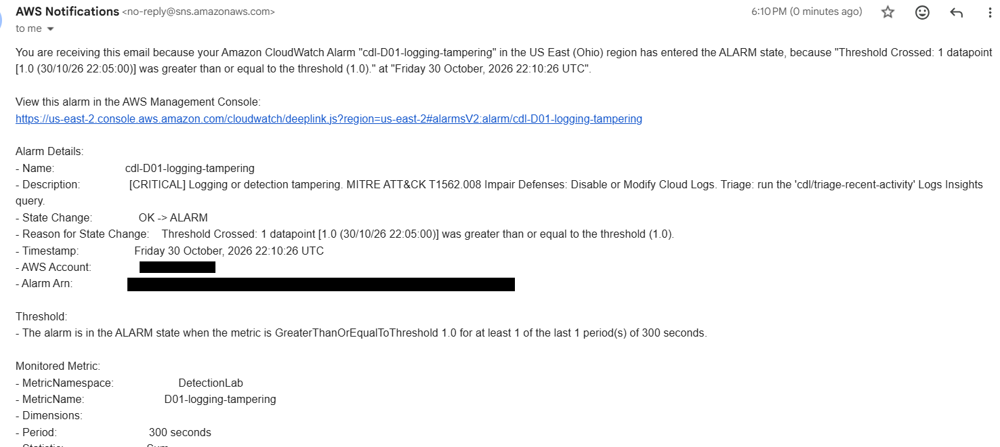
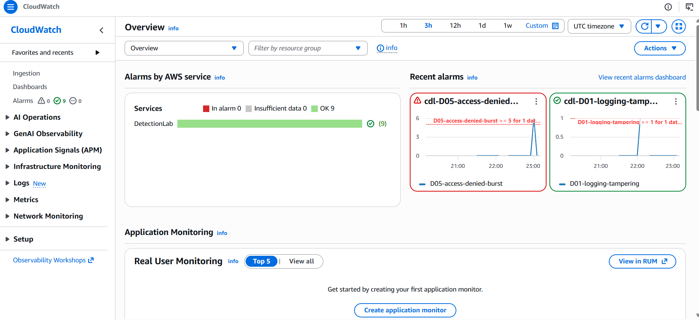
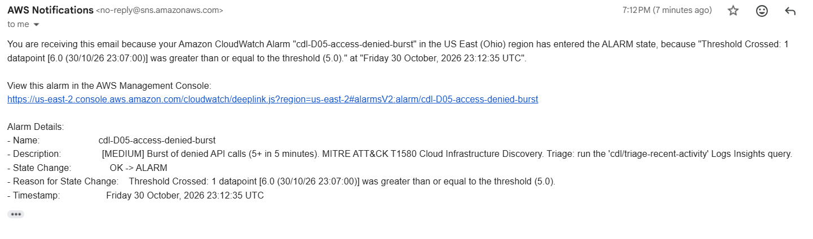
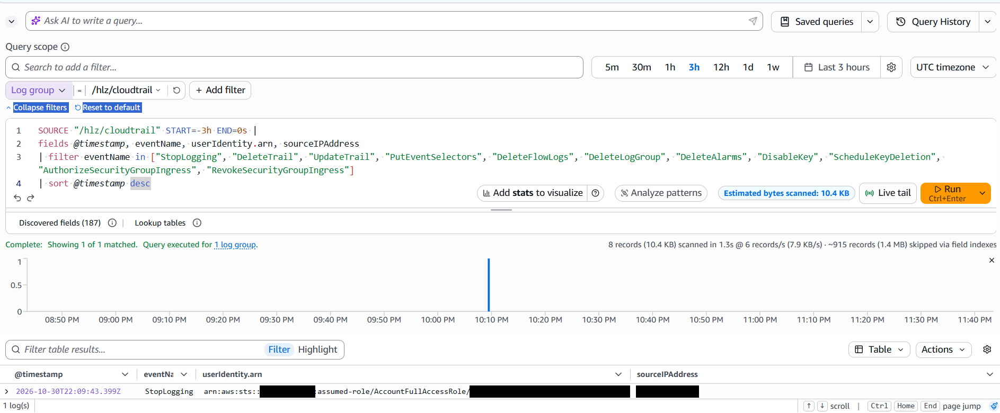
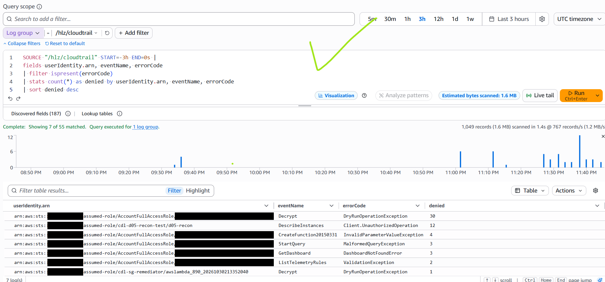
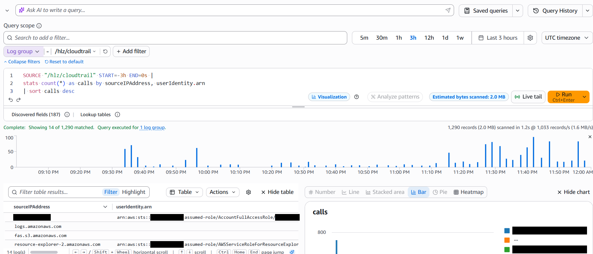
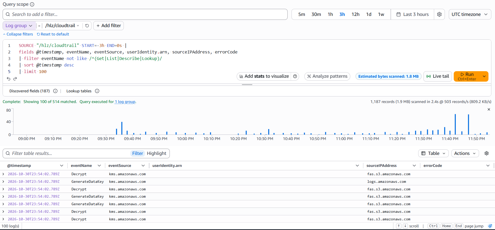

# Results: first live run

October 27, 2026, on an AWS free-plan "projects" account in us-east-2.
Account numbers, session IDs, request IDs and the alert email address are
blacked out in every screenshot.

## Headline numbers

| Measure | Result |
|---------|--------|
| Resources deployed | 29 (landing zone) + 33 (lab) |
| World-open SSH rule closed automatically | **9 s** (test 1), **7 s** (test 2), from the API call to the revoke |
| Lambda run time | 4.7 s |
| D02 alarm email after the change | **2 min 14 s** (test 2) |
| Cost | $0; everything destroyed at the end of the session |

Times come from CloudTrail event history (the `AuthorizeSecurityGroupIngress`
call and the Lambda's `RevokeSecurityGroupIngress`), the Lambda log, and the
alarm's own timestamp.

## 1. Deploy

The landing zone was rebuilt with `cloudtrail_to_cloudwatch=true` (29
resources), then the lab on top of it.

## 2. Simulated attack: SSH opened to the internet

On a throwaway security group attached to nothing, port 22 was opened to
`0.0.0.0/0`, the misconfiguration MITRE ATT&CK tracks as T1562.007.

## 3. Automatic response

EventBridge caught the API call and invoked `cdl-sg-remediator`. A few seconds
later the group's inbound rules were empty (`[]`), and the function's log
records exactly what it revoked.

The alert names the group, who opened the rule, what was removed, the ATT&CK
technique, and the analyst's next step.

## 4. Detection

The CloudWatch alarm for D02 crossed its threshold and emailed the SOC topic
with severity, technique and the triage query to run.

## 5. Investigation: the timeline in CloudTrail

Both test runs read cleanly in CloudTrail event history: the human opens the
rule, and the remediator (its own identity, `cdl-sg-remediator`) closes it
seconds later.

| Time (ET) | Event | Who |
|-----------|-------|-----|
| 22:38:48 | CreateSecurityGroup | analyst session |
| 22:40:23 | AuthorizeSecurityGroupIngress (port 22, 0.0.0.0/0) | analyst session |
| 22:40:32 | RevokeSecurityGroupIngress | cdl-sg-remediator |
| 22:58:00 | AuthorizeSecurityGroupIngress (test 2) | analyst session |
| 22:58:07 | RevokeSecurityGroupIngress | cdl-sg-remediator |
| 23:00:14 | D02 alarm OK → ALARM | CloudWatch |
| 23:37:32 | DeleteSecurityGroup (cleanup) | analyst session |

## 6. Tear down

The landing zone was destroyed after it (29 resources).

## What went wrong, and what it taught me

- **I got stood up.** Of course the first test's alerts didn't arrive. I was
  waiting and thought I'd been stood up, but it was my error: I didn't confirm
  the date. I was overzealous and ran the test before clicking the SNS
  confirmation link, and SNS drops messages to an unconfirmed subscription
  without any error. (The fix itself still worked, in 9 seconds.) Now I check
  `aws sns list-subscriptions-by-topic` before testing.
- **Response beats detection on speed.** The automatic fix closed the hole in
  7 to 9 seconds; the alarm took just over 2 minutes because CloudTrail
  batches delivery to CloudWatch Logs and the alarm evaluates 5-minute
  periods. Detection still matters: it creates the record a human reviews.
- **Attribution works.** CloudTrail separates the person who opened the rule
  from the function that closed it, which is what an investigator needs.

## Second live run: detections and hunting

October 30, 2026, same account and region. The landing zone was redeployed
with `cloudtrail_to_cloudwatch=true` and the lab applied on top (9 metric
filters, 9 alarms, SNS subscription confirmed before testing).

### Headline numbers

| Detection | Self-test | Alarm | Time to alert |
|-----------|-----------|-------|---------------|
| D01 logging tampering | `StopLogging` on the lab's own trail, then `StartLogging` at once | OK → ALARM | **43 s** (22:09:43 → 22:10:26 UTC) |
| D05 denied-call burst | 6 `ec2:DescribeInstances` calls from a role with no permissions | OK → ALARM (6 vs threshold 5) | **2 min 19 s** (19:10:16 → 19:12:35 ET) |

The D01 time comes from the `StopLogging` event's own timestamp in CloudTrail,
not from the shell clock, which was read a couple of minutes before the
command was typed.

### D01: someone turns off the audit trail

Logging was back on (`IsLogging: true`) within minutes. Both alarms show as
single spikes on the CloudWatch overview, and every alarm returned to OK on
its own once the 5-minute window passed:

### D05: a low-privilege identity probing the account

A temporary role, `cdl-d05-recon-test`, was created with a trust policy for
the account only and **no permissions**. It was assumed, used for six EC2
lookups in Ohio (each returned `UnauthorizedOperation`), and deleted straight
after.

### Hunting: what the saved queries showed

| Query | Result |
|-------|--------|
| `defense-evasion` | Found the single `StopLogging` call among about 920 events, with who and from where |
| `denied-calls-by-identity` | Put `cdl-d05-recon-test/d05-recon` near the top: 12 `UnauthorizedOperation` on `DescribeInstances` (both runs) |
| `triage-recent-activity` | 514 matches, topped by AWS services calling KMS for log encryption (noise; tuned below) |
| `new-credentials-and-users` | Nothing: IAM events don't reach this trail (finding 1) |
| `activity-by-source-ip` | 14 sources: one human IP address, plus AWS service principals |

### Findings

1. **A single-Region trail is blind to global IAM events.** The first D05
   attempt used six `iam:CreateOpenIDConnectProvider` calls; all six were
   denied by the account's SCP, but IAM records its events in us-east-1 and
   the trail lives in us-east-2, so neither the alarm nor any query saw them.
   The re-run used a regional service (EC2) and fired. The test role's own
   `CreateRole` is missing from the logs for the same reason. Fix on a
   standard account: `multi_region_trail = true`.
2. **The detection ignored noise correctly.** `denied-calls-by-identity`
   also listed 30+ `DryRunOperationException` errors from AWS services checking
   KMS permissions, plus a few malformed console queries. None of them match
   D05's pattern (`AccessDenied*` or `*UnauthorizedOperation`), so none of
   them raised an alert.
3. **Triage needed tuning.** Most "write" events in the last hours were AWS
   services (S3, CloudWatch Logs) using KMS on the encrypted log bucket. The
   triage query now drops `userIdentity.type = "AWSService"` so human actions
   come first, and the credentials hunt now also covers `CreateRole` and
   `CreatePolicy` for when the trail is multi-Region.
4. **Attribution across identities.** `activity-by-source-ip` ties the test
   role and the analyst role to the same source IP address, which is how an
   investigator links a throwaway identity back to the person behind it.
5. **S3 bucket creation is allowed on this account.** A first D05 idea
   (creating buckets with global names) wasn't denied at all: seven empty
   test buckets were created and deleted at once. A self-test has to be
   checked with one call before it's run as a burst.
